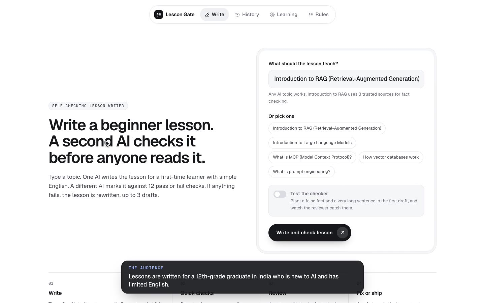
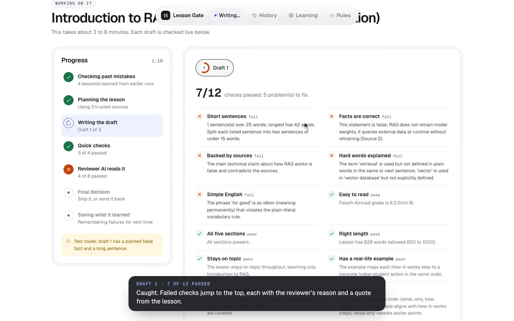
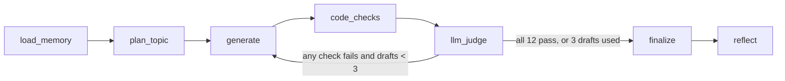
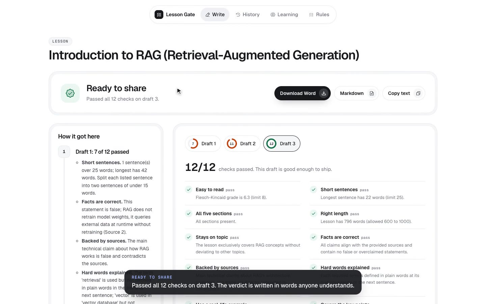
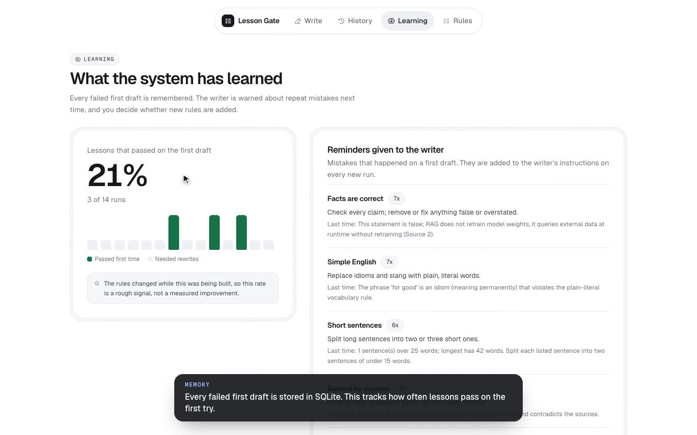
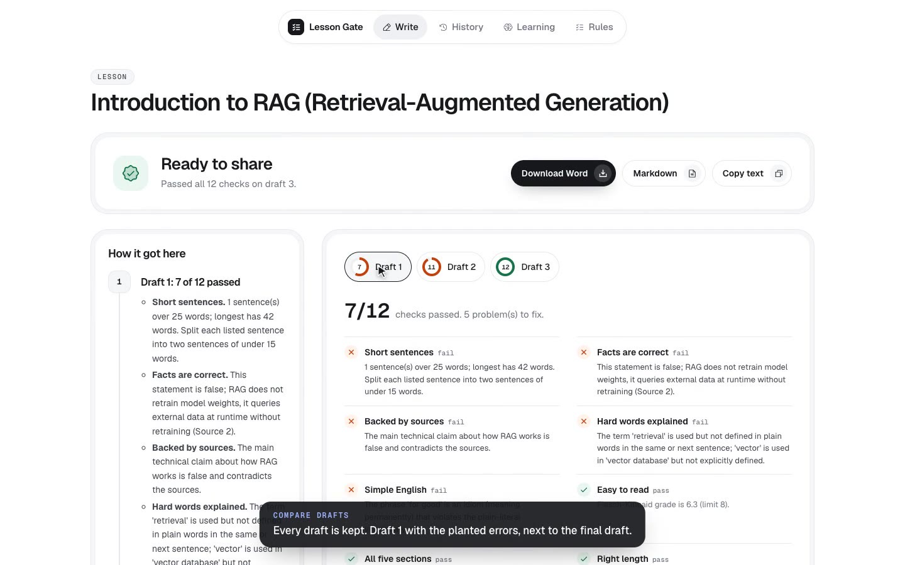
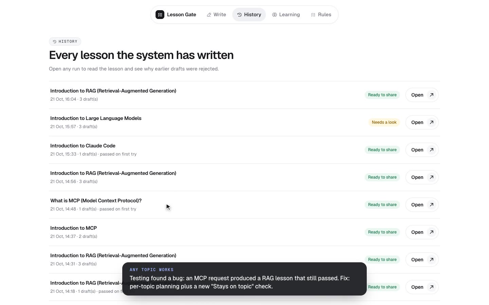
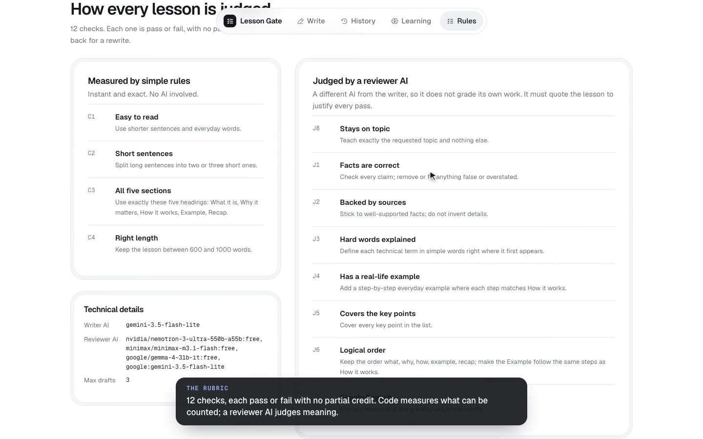
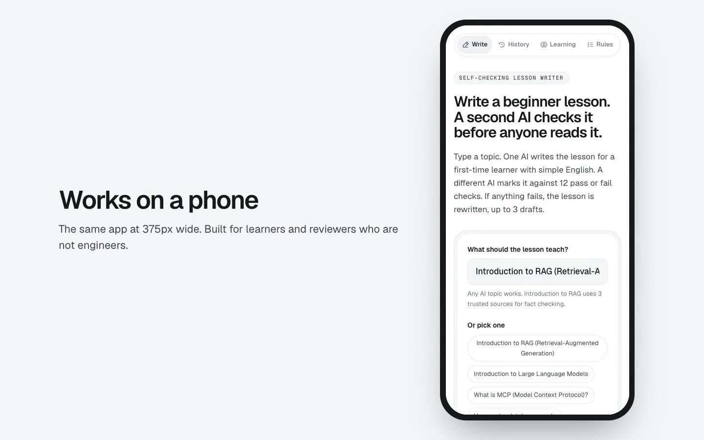

# Lesson Gate

**A self-evaluating lesson generator.** One AI writes a beginner lesson. A second AI, from a different model family, grades it against 12 hard pass/fail checks. Any failure goes back to the writer with the exact reasons, up to 3 drafts. The system remembers every mistake and uses it on the next run.

Built for the GenAI Engineer (Content Systems) take-home. Submission topic: **Introduction to RAG**, for a 12th-grade graduate in India with limited English and no AI background.



## Submission

| Deliverable | Link |
|---|---|
| GitHub repo (agentic workflow + this README) | You are here |
| Final lesson (Google Doc) | _Add Google Doc link here_ · in-repo copy: [docs/lesson_rag.md](docs/lesson_rag.md) · [Word file](docs/lesson_rag.docx) |
| Loom walkthrough (15 to 20 min, face visible) | _Add Loom link here_ |
| Narrated product demo (2:40) | [demo/lesson-gate-demo-voiceover.mp4](demo/lesson-gate-demo-voiceover.mp4) |
| Design notes and iteration log | [docs/DESIGN.md](docs/DESIGN.md) |

## The result in one picture

The run behind the final lesson (run 14), with "Test the checker" switched on, so draft 1 contained a planted false fact and a 42-word run-on sentence with an idiom:

| Draft | Score | What the evaluator said | What happened next |
|---|---|---|---|
| 1 | 7 / 12 | **C2** a 42-word sentence · **J1** "RAG does not retrain model weights" · **J2** claim contradicts the sources · **J3** "retrieval" not defined · **J7** "for good" is an idiom | All five reasons, with the offending text, went back to the writer |
| 2 | 11 / 12 | **J3** "retrieval" still not defined where it first appears | Sent back once more, rewriting from the best draft so far |
| 3 | **12 / 12** | Every check passed | Shipped as "Ready to share" |



## How it works



| Node | What it does |
|---|---|
| `load_memory` | Reads recurring first-draft mistakes ("pitfalls") and human-approved rules from SQLite. |
| `plan_topic` | Picks the topic profile. RAG has a curated pack of 3 sources (Lewis et al. 2020, AWS, IBM). Any other topic gets key points and terms planned by the writer model, marked as ungrounded. |
| `generate` | Gemini (`gemini-3.5-flash-lite`) writes the lesson. On a retry it receives the failed checks, the exact problem text and a list of earlier fixes it must not undo. |
| `code_checks` | 4 deterministic checks in plain Python (textstat, regex). Free, instant and exact. |
| `llm_judge` | 8 checks in one call to a reviewer from another model family (OpenRouter free models, Gemini as a last-resort fallback). Returns strict JSON. |
| `decide` | All 12 pass: ship. Any fail with drafts left: rewrite. 3 drafts used: ship the best draft flagged `FAILED_QA`. The loop always ends. |
| `finalize` / `reflect` | Picks the best draft, saves the run, updates pitfall counts and, when a mistake repeats, drafts a new rule for a human to approve. |

Built with **LangGraph** (state machine with a conditional edge and a hard cap), **FastAPI** (streams every node update over SSE), **React** (live UI) and **SQLite** (memory).

## The rubric: 12 hard pass/fail checks

No partial credit. One fail rejects the draft.

| ID | Check | Checked by | Pass condition |
|---|---|---|---|
| C1 | Easy to read | Code | Flesch-Kincaid grade 8 or lower |
| C2 | Short sentences | Code | No sentence over 25 words |
| C3 | All five sections | Code | What it is · Why it matters · How it works · Example · Recap |
| C4 | Right length | Code | 600 to 1,000 words |
| J8 | Stays on topic | Reviewer AI | The whole lesson teaches the requested topic |
| J1 | Facts are correct | Reviewer AI | Nothing false or overclaimed (RAG lowers hallucination risk; it does not remove it) |
| J2 | Backed by sources | Reviewer AI | Main claims are supported by the source pack |
| J3 | Hard words explained | Reviewer AI | Every listed term is defined in plain words where it first appears |
| J4 | Has a real-life example | Reviewer AI | An everyday Indian student example whose steps match How it works |
| J5 | Covers the key points | Reviewer AI | Retrieve, augment, generate; hallucination; stale knowledge; embeddings and a vector store |
| J6 | Logical order | Reviewer AI | Ideas build in order; the example mirrors the steps |
| J7 | Simple English | Reviewer AI | No idioms or slang |

The full conditions live in [backend/rubric.py](backend/rubric.py), the single source of truth for the writer prompt, the judge prompt and the UI.

## Why the evaluator can be trusted

| Design choice | Why |
|---|---|
| **Code first, AI second** | Anything countable (reading level, sentence length, sections, word count) is measured in code. Models are unreliable at counting their own words. |
| **A different model family judges** | A model grading its own writing tends to accept its own habits. Gemini writes; an NVIDIA or MiniMax model reviews. |
| **Evidence or it fails** | The judge must quote the lesson for every pass. If the quote is not actually in the lesson, the pass is flipped to a fail. |
| **Grounded in sources** | For RAG, both writer and judge see the same 3-source pack, so "accurate" means "consistent with the sources". |
| **Binary checks** | A fail always comes with one reason that can be fed straight back to the writer. Scores out of 10 cannot be acted on. |
| **One judge call per draft** | All 8 judged checks in a single JSON call keeps the run inside the free tier (50 requests a day). Results are cached by prompt hash. |
| **Topic check (J8)** | Added after testing showed a request for "MCP" could produce a RAG lesson that still passed. |

## Regenerate: how a rewrite is steered

- The writer gets each failed check, the reviewer's reason and the exact problem text.
- It also gets "earlier fixes": problems from older drafts it must not bring back.
- It always rewrites the **best** draft so far, so one bad rewrite cannot throw away a good draft.
- It reports what it changed, which becomes the "What the writer changed next" line in the rejection log.



## Memory and self-evolution

| Layer | What is stored | How it is used |
|---|---|---|
| Runs | Every run, draft, failed check and reason (SQLite) | History page, rejection logs, first-draft pass rate |
| Pitfalls | Checks that failed on a first draft, with a count | Injected into the writer prompt on every new run, on any topic |
| Proposals | A drafted rule when the same mistake repeats | Shown in the UI; added to every future prompt only after a human approves |
| Topic plans | Key points and terms for non-RAG topics | Reused so the same topic is judged the same way next time |



The first-draft pass rate is shown honestly as a rough signal: the rubric was tightened during development, so early and late runs are not directly comparable.

## The app

| Page | What you can do |
|---|---|
| **Write** | Type any topic, optionally plant an error, and watch each draft being checked live in plain words. Read the final lesson, compare drafts and download it as Word or Markdown. |
| **History** | Reopen any lesson with its full rejection log. |
| **Learning** | See the first-draft pass rate, the reminders given to the writer, and approve or reject suggested rules. |
| **Rules** | The 12 checks explained for non-engineers, plus the models in use. |

| | |
|---|---|
|  |  |
|  |  |

## Setup and run

**Requirements:** Python 3.12, Node 20+, a Google AI Studio key (Gemini) and an OpenRouter key. Both have free tiers.

```bash
git clone https://github.com/Avinashhmavi/Self-Evaluating-Lesson-Content-Generator.git
cd Self-Evaluating-Lesson-Content-Generator
```

```bash
uv venv --python 3.12 .venv && uv pip install --python .venv/bin/python -r requirements.txt
```

Without `uv`: `python3.12 -m venv .venv && .venv/bin/pip install -r requirements.txt`

```bash
cp .env.example .env
```

Add `GOOGLE_API_KEY` and `OPENROUTER_API_KEY` to `.env`, then install the frontend:

```bash
cd frontend && npm install && cd ..
```

**Run** (two terminals):

```bash
.venv/bin/uvicorn api:app --app-dir backend --port 8000
```

```bash
cd frontend && npm run dev
```

Open http://localhost:5173. A run takes about 3 to 8 minutes, mostly waiting for the free reviewer model.

**Command line** (no UI; `--inject` plants the deliberate error):

```bash
.venv/bin/python backend/cli.py "Introduction to RAG (Retrieval-Augmented Generation)" --inject
```

**Tests** (offline, mocked models, no API calls):

```bash
.venv/bin/python -m pytest backend/tests -q
```

The 8 tests cover the code checks, catching an injected error and recovering, the 3-draft cap, pitfalls reaching the next run, non-RAG topics never seeing the RAG sources, the judge rejecting passes it cannot quote, the Word download and input validation.

**Optional settings** (`.env`): `GEN_MODEL`, `JUDGE_MODELS` (comma-separated, tried in order), `PITFALL_MIN`.

## Project structure

```
backend/
  graph.py         LangGraph state machine: nodes, retry logic, deliberate-error injection
  rubric.py        The 12 checks and their per-topic templates
  checks.py        Code checks (textstat, regex)
  judge.py         Judge prompt, JSON parsing, evidence verification, cache, model fallback
  topics.py        Topic profiles and the planner for new topics
  topics/rag/      RAG source pack (3 sources) and key points
  memory.py        SQLite: runs, failures, pitfalls, proposals, caches
  api.py           FastAPI: SSE run stream, history, Word export, proposals
  prompts/         Writer and judge prompt templates
  tests/           Offline test suite
frontend/src/      React app: Write, History, Learning, Rules
docs/              Final lesson, design notes, Loom script, screenshots
demo/              Narrated demo video
```

## Honest limits

- **Free models are slow.** The reviewer takes 1 to 3 minutes per draft, and the free tier allows 50 requests a day.
- **The judge can be wrong.** Two free models once disagreed on the same lesson. A human-labelled calibration set is the next step.
- **Only RAG has a source pack.** Other topics are planned and judged from model knowledge, and the UI says so.
- **Learning is not yet proven.** A fair test needs a frozen rubric and 20 or more runs.
- **Analogy quality is only partly checked.** The judge confirms each step has a matching everyday action. How apt the analogy is remains a human call.

## What I would build next

1. A human-labelled set of good and bad lessons to measure judge precision and recall.
2. Two reviewers with majority vote on the 8 judged checks, using a paid model for speed.
3. Source packs for more topics, retrieved and cited automatically.
4. An A/B test with a frozen rubric to measure whether pitfall memory raises first-draft pass rate.
